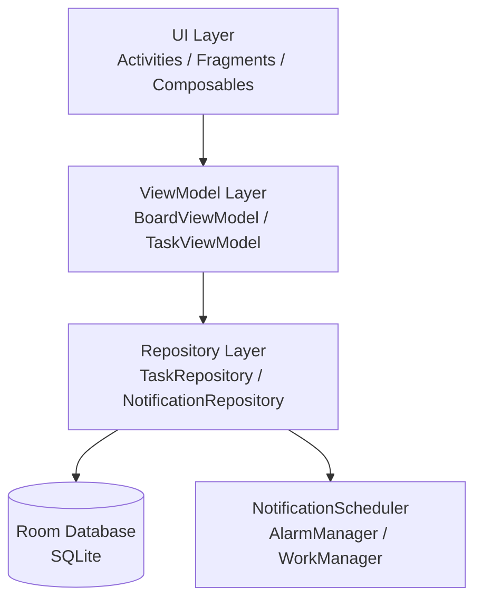

# Design Document: Android Task Board

## Overview

The Android Task Board is a native Android application that provides a Kanban-style task management experience. Users can create, organize, and track tasks across status columns (To Do, In Progress, Done) with support for priorities, due dates, local notifications, and offline-first persistence via Room/SQLite.

The app follows the MVVM (Model-View-ViewModel) architecture pattern with a Repository layer, which is the recommended approach for Android development. All data is stored locally — no backend or network connectivity is required.

## Architecture



The architecture layers:

- UI Layer: Jetpack Compose screens for the Board, Task Detail, Task Form, and Settings
- ViewModel Layer: Holds UI state, exposes StateFlow/LiveData, handles user actions
- Repository Layer: Single source of truth; abstracts Room and notification scheduling
- Room Database: Local SQLite persistence for all task data
- NotificationScheduler: Schedules/cancels AlarmManager-based local notifications

## Components and Interfaces

### BoardViewModel

Exposes the board state to the Board screen.

```kotlin
class BoardViewModel(private val repo: TaskRepository) : ViewModel() {
    val boardState: StateFlow<BoardState>
    val searchQuery: StateFlow<String>
    val activeFilter: StateFlow<PriorityFilter>

    fun onSearchQueryChanged(query: String)
    fun onPriorityFilterChanged(filter: PriorityFilter)
    fun onClearFilters()
    fun onTaskMoved(taskId: Long, newStatus: TaskStatus)
}
```

### TaskViewModel

Handles task creation, editing, and deletion.

```kotlin
class TaskViewModel(private val repo: TaskRepository) : ViewModel() {
    val taskDetail: StateFlow<Task?>
    val validationState: StateFlow<ValidationState>

    fun loadTask(taskId: Long)
    fun saveTask(form: TaskForm): Result<Unit>
    fun deleteTask(taskId: Long)
}
```

### TaskRepository

```kotlin
interface TaskRepository {
    fun getAllTasks(): Flow<List<Task>>
    suspend fun getTaskById(id: Long): Task?
    suspend fun insertTask(task: Task): Long
    suspend fun updateTask(task: Task)
    suspend fun deleteTask(taskId: Long)
}
```

### NotificationScheduler

```kotlin
interface NotificationScheduler {
    fun schedule(task: Task)
    fun cancel(taskId: Long)
    fun cancelAll()
}
```

### Board Screen (Compose)

The main screen renders three `LazyColumn` lanes side-by-side in a `Row` inside a horizontal `ScrollableRow`. Each lane shows a column header with a task count badge and a list of `TaskCard` composables.

Drag-and-drop is handled via the Compose drag-and-drop API (available from Compose 1.5+) or a long-press context menu fallback for older API levels.

## Data Models

### Task Entity (Room)

```kotlin
@Entity(tableName = "tasks")
data class Task(
    @PrimaryKey(autoGenerate = true) val id: Long = 0,
    val title: String,                    // 1–100 chars, required
    val description: String = "",         // 0–500 chars
    val priority: Priority = Priority.MEDIUM,
    val status: TaskStatus = TaskStatus.TODO,
    val dueDate: Long? = null,            // epoch millis, nullable
    val notificationsEnabled: Boolean = false,
    val createdAt: Long = System.currentTimeMillis()
)
```

### Enums

```kotlin
enum class Priority { LOW, MEDIUM, HIGH }

enum class TaskStatus { TODO, IN_PROGRESS, DONE }
```

### BoardState (UI model)

```kotlin
data class BoardState(
    val columns: Map<TaskStatus, List<Task>>,
    val taskCounts: Map<TaskStatus, Int>
)
```

### TaskForm (input model)

```kotlin
data class TaskForm(
    val title: String,
    val description: String,
    val priority: Priority,
    val dueDate: Long?,
    val notificationsEnabled: Boolean
)
```

### ValidationResult

```kotlin
sealed class ValidationResult {
    object Valid : ValidationResult()
    data class Invalid(val errors: List<ValidationError>) : ValidationResult()
}

enum class ValidationError { TITLE_EMPTY, TITLE_TOO_LONG, DESCRIPTION_TOO_LONG }
```

### Room Database

```kotlin
@Database(entities = [Task::class], version = 1)
abstract class AppDatabase : RoomDatabase() {
    abstract fun taskDao(): TaskDao
}
```

### TaskDao

```kotlin
@Dao
interface TaskDao {
    @Query("SELECT * FROM tasks ORDER BY createdAt DESC")
    fun observeAll(): Flow<List<Task>>

    @Query("SELECT * FROM tasks WHERE id = :id")
    suspend fun getById(id: Long): Task?

    @Insert suspend fun insert(task: Task): Long
    @Update suspend fun update(task: Task)
    @Delete suspend fun delete(task: Task)
}
```

## Correctness Properties

*A property is a characteristic or behavior that should hold true across all valid executions of a system — essentially, a formal statement about what the system should do. Properties serve as the bridge between human-readable specifications and machine-verifiable correctness guarantees.*


### Property 1: Task appears in correct column

*For any* list of tasks with arbitrary statuses, when the board state is computed, each task SHALL appear in exactly the column that matches its status (TODO → "To Do", IN_PROGRESS → "In Progress", DONE → "Done") and in no other column.

**Validates: Requirements 1.2, 3.1, 3.3**

---

### Property 2: Column badge count equals task count

*For any* list of tasks, the badge count displayed on each column header SHALL equal the number of tasks whose status maps to that column.

**Validates: Requirements 1.5**

---

### Property 3: Task form validation accepts only valid inputs

*For any* task form input, the validator SHALL accept the form if and only if the title is between 1 and 100 characters (inclusive) and the description is at most 500 characters; all other combinations SHALL be rejected with a validation error.

**Validates: Requirements 2.2, 2.3, 2.7**

---

### Property 4: Task field round-trip through storage

*For any* valid task (with any combination of title, description, priority, due date, and status), inserting it into the Room database and then retrieving it by ID SHALL produce a task whose fields are identical to the inserted task.

**Validates: Requirements 2.4, 2.5, 2.6, 6.1, 6.2**

---

### Property 5: Task edit round-trip

*For any* existing task and any valid set of edited field values, saving the edited task to storage and then retrieving it SHALL produce a task whose fields exactly match the edited values.

**Validates: Requirements 4.2**

---

### Property 6: Deletion removes task from storage

*For any* task present in storage, after confirming deletion the task SHALL no longer be retrievable from storage, and all other tasks SHALL remain unchanged.

**Validates: Requirements 4.4, 4.5**

---

### Property 7: Search filter returns only matching tasks

*For any* task list and any search query string, the filtered result SHALL contain exactly those tasks whose title or description contains the query (case-insensitive), and no tasks that do not match.

**Validates: Requirements 5.1**

---

### Property 8: Priority filter returns only matching tasks

*For any* task list and any selected priority level, the filtered result SHALL contain exactly those tasks whose priority equals the selected level, and no tasks with a different priority.

**Validates: Requirements 5.2**

---

### Property 9: Clearing filters restores full task list

*For any* task list and any combination of active filters, clearing all filters SHALL produce a result equal to the original unfiltered task list.

**Validates: Requirements 5.3**

---

### Property 10: Notification scheduled for every task with due date and notifications enabled

*For any* task with a non-null due date and notifications enabled, calling the NotificationScheduler SHALL result in exactly one notification being scheduled for that task's due date and time.

**Validates: Requirements 8.1, 8.4**

---

### Property 11: Notification content contains task title and due time

*For any* task with a non-null due date, the notification built for that task SHALL contain the task's title and formatted due time in its content.

**Validates: Requirements 8.2**

---

### Property 12: Notification lifecycle follows task lifecycle

*For any* task with a pending notification: (a) disabling notifications for that task SHALL cancel the pending notification; (b) updating the task's due date SHALL cancel the old notification and schedule a new one for the updated time; (c) deleting the task SHALL cancel the pending notification.

**Validates: Requirements 8.5, 8.8, 8.9**

---

### Property 13: Global notification toggle suppresses all scheduling

*For any* task with a due date and notifications enabled, if the global notification toggle is disabled, the NotificationScheduler SHALL not schedule any notification for that task.

**Validates: Requirements 8.7**

---

## Error Handling

| Scenario | Handling |
|---|---|
| Storage write failure | Catch exception in Repository, emit error state via StateFlow, retain in-memory data for session |
| Storage read failure | Emit empty list with error state; show snackbar |
| Notification scheduling failure | Log error, set `notificationError = true` on task, show warning badge on card |
| POST_NOTIFICATIONS denied | Disable scheduling globally, show informational dialog |
| Invalid task form submission | Show inline validation errors, retain form data |
| Task not found (deep link / notification tap) | Show "Task not found" message, navigate to board |

All Repository suspend functions wrap Room calls in `try/catch` and return `Result<T>` to the ViewModel. The ViewModel maps `Result.failure` to a UI error state exposed via `StateFlow<UiEvent>`.

## Testing Strategy

### Unit Tests

Focus on specific examples, edge cases, and error conditions:

- `TaskValidator`: boundary values for title (0, 1, 100, 101 chars) and description (0, 500, 501 chars)
- `BoardStateMapper`: tasks with each status map to the correct column
- `TaskRepository`: mock DAO, verify insert/update/delete calls and error propagation
- `NotificationSchedulerImpl`: mock AlarmManager, verify schedule/cancel calls
- `BoardViewModel`: filter logic, search logic, clear filters
- Error states: mock DAO throwing exceptions, verify ViewModel error state

### Property-Based Tests

Use [Kotest](https://kotest.io/) with its property-based testing module (`kotest-property`) — minimum 100 iterations per property.

Each property test is tagged with a comment referencing the design property:
```
// Feature: android-task-board, Property N: <property text>
```

Properties to implement as property-based tests:

| Property | Generator | Assertion |
|---|---|---|
| 1: Task in correct column | `Arb.list(Arb.task())` | Each task in `boardState.columns[task.status]` |
| 2: Column badge count | `Arb.list(Arb.task())` | `count == tasks.count { it.status == col }` |
| 3: Form validation | `Arb.string()` for title/description | Accept iff length in valid range |
| 4: Field round-trip | `Arb.task()` | Retrieved task equals inserted task |
| 5: Edit round-trip | `Arb.task()`, `Arb.taskForm()` | Retrieved task equals edited values |
| 6: Deletion removes task | `Arb.list(Arb.task())` | Deleted task absent, others unchanged |
| 7: Search filter | `Arb.list(Arb.task())`, `Arb.string()` | All results contain query, no non-matches |
| 8: Priority filter | `Arb.list(Arb.task())`, `Arb.enum<Priority>()` | All results match priority |
| 9: Clear filters | `Arb.list(Arb.task())`, random filters | Result equals original list |
| 10: Notification scheduled | `Arb.task(withDueDate = true)` | Scheduler called with correct time |
| 11: Notification content | `Arb.task(withDueDate = true)` | Notification contains title and due time |
| 12: Notification lifecycle | `Arb.task(withDueDate = true)` | Cancel/reschedule called correctly |
| 13: Global toggle suppresses | `Arb.task(withDueDate = true)` | No schedule call when toggle off |

### Integration Tests

- Room database: insert 500 tasks, verify read completes within 200ms
- End-to-end board load: seed DB, open board, verify all tasks displayed
- Notification delivery: schedule notification, advance clock, verify delivery

### Smoke Tests

- Build verification: AAB produced, target SDK 34, min SDK 26
- Manifest inspection: only required permissions declared
- POST_NOTIFICATIONS permission request triggered on API 33+
